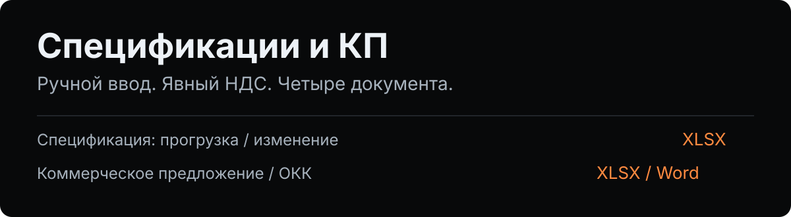

# Панель спецификаций и КП



Локальная демонстрация закупочного инструмента: заполните плотную таблицу, проверьте цены с НДС и без него, скачайте спецификацию или коммерческое предложение. Работает на FastAPI и обычном JavaScript, без сборки фронтенда.

**Это портфолио-версия, не публичный многопользовательский сервис.** Данные каталога вымышлены, формы учебные. Не вводите рабочие, личные или конфиденциальные сведения.

## Попробовать

Нужны **Python 3.11 или новее** и `venv`. Из каталога проекта:

```bash
python3 -m venv .venv
. .venv/bin/activate
python -m pip install -r requirements.txt
python -m uvicorn app.main:app --host 127.0.0.1 --port 8098
```

Откройте **http://127.0.0.1:8098/** на той же машине. Кнопка «Заполнить пример» добавит четыре вымышленных товара и демонстрационного поставщика. Выберите «Прогрузка цен» или «Изменение цен», скачайте XLSX; на вкладке «КП и ОКК» доступны Excel и Word.

Остановка: `Ctrl+C`. Активная таблица живёт только в памяти вкладки: перезагрузка страницы её сбросит. Интернет нужен для первой установки Python-пакетов, но не для работы приложения.

## Четыре формы

| Выгрузка | Содержимое |
| --- | --- |
| Спецификация: прогрузка, XLSX | Артикул, название, упаковка, НДС, цены штуки и коробки |
| Спецификация: изменение, XLSX | Старые и новые цены, изменение в процентах |
| КП, XLSX | Свободное название, производитель, цены, себестоимость и наценка |
| ОКК, DOCX | Нейтральное коммерческое предложение в Word, без подписи и печати |

- **Поставщик обязателен** во всех четырёх формах, вводится свободно и попадает в документ и безопасное имя файла.
- **НДС — явно 0, 10, 20 или 22%.** Ставка 20% остаётся 20%; для неизвестного артикула ставка и цена не придумываются.
- **Цены двусторонние:** можно начать с суммы с НДС или без него. Строки и итоги пересчитываются при вводе. Название КП/ОКК свободное, подсказки не навязываются.
- В каталоге только `DEMO-001` — `DEMO-004`. Для другого артикула заполните название, упаковку, НДС и цену вручную. Список артикулов можно вставить пачкой.
- **До 500 строк** в документе, без обрезки после 8 или 20. Превышение лимита отклоняется с ошибкой.
- Итоги означают **по одной коробке каждой позиции**, а не стоимость заказа: отдельного количества заказа здесь нет.

### Правила расчёта

Сервер считает через `Decimal`, округляет цену штуки до копейки по `ROUND_HALF_UP`, затем умножает на количество штук в коробке. Цена без НДС — основная; при вводе только цены с НДС сервер сначала восстанавливает цену без НДС. Для пары цен допускается расхождение не больше одной копейки из-за обратного округления; в файл записывается пересчитанная пара.

Цены должны быть конечными, строго положительными и не больше 1 000 000 000. Штук в коробке — целое число от 1 до 1 000 000. Сервер не доверяет проверкам браузера. В XLSX записываются уже вычисленные значения, **не формулы**: документ открывается с готовыми суммами даже без движка пересчёта. Если вручную изменить выгруженный XLSX, зависимые ячейки автоматически не обновятся — исправьте таблицу в панели и выгрузите заново.

## Проверка

```bash
. .venv/bin/activate
python -m pip install -r requirements-dev.txt
python -m pytest -q
```

Тесты не обращаются в сеть. Они выполняют запросы к реальному приложению через `TestClient`, сохраняют ответы в отдельные временные каталоги, снова открывают XLSX/DOCX и проверяют значения, все строки, НДС, обязательного поставщика, вредоносный текст, ограничения запросов и очистку выгрузок. Прямые зависимости и их транзитивные версии закреплены.

Для проверки обработчиков интерфейса без библиотек нужен Node.js 22+:

```bash
node tests/ui.test.cjs
```

CI запускает оба набора проверок на Python 3.11 и 3.13. Установка зависимостей в CI требует сеть; сами тесты автономны.

## Безопасность и границы

- По умолчанию сервер слушает только `127.0.0.1`. **Не меняйте адрес на `0.0.0.0`, не публикуйте этот сервер через туннель или обратный прокси.** Нет авторизации, разграничения пользователей, ограничения частоты запросов и производственной эксплуатации.
- Разрешены только `Host` для `127.0.0.1`, `localhost` и `[::1]`. Если есть `Origin`, он должен точно совпадать с локальной схемой, адресом и портом. `Sec-Fetch-Site: cross-site` и `same-site` отклоняются.
- POST принимает только JSON с `X-Panel-Request: 1`; CORS не включён. Тело запроса ограничено 2 МиБ. Пример прямого API-запроса смотрите в `tests/test_exports.py`.
- Ответы имеют `no-store`, `nosniff`, `DENY` и CSP. Сохранённые из исходного интерфейса встроенные обработчики требуют `unsafe-inline` для JS/CSS; это осознанное ограничение локальной демонстрации, а не строгая производственная CSP.
- Нет внешних JavaScript, CDN, телеметрии, сторонних шрифтов, почты, фоновой синхронизации или обращений к базам данных. Шрифты — только системные.
- Формы создаёт **`scripts/create_demo_templates.py`** через openpyxl/python-docx при старте, только внутри `generated/templates/` этого проекта. Исходных офисных файлов в репозитории нет. Они не содержат картинок, внешних связей, макросов, реквизитов и подписей.
- Для каждой выгрузки создаётся свой `TemporaryDirectory` в `generated/exports/`. После отправки или ошибки генерации он удаляется; история документов не ведётся. При аварийном завершении процесса временный каталог может остаться — после остановки можно удалить весь `generated/`.
- Текстовые ячейки Excel с началом `=`, `+`, `-` или `@` получают апостроф. Это предотвращает исполнение введённого текста как формулы. Управляющие символы и чрезмерно длинные поля отклоняются; имя поставщика отдельно очищается для `Content-Disposition`.

Удаление созданных локальных форм и остатков выгрузок после остановки:

```bash
python -c "import shutil; shutil.rmtree('generated', ignore_errors=True)"
```

## Происхождение

Это очищенная самостоятельная адаптация авторского **category-panel**, а не приложение, написанное заново. Сохранены тёмный плотный интерфейс, схемы таблиц, редактор строк, пакетный ввод артикулов, двусторонние обработчики цен, уведомления и код заполнения Excel/Word. Изменены границы ввода, правила расчёта и транспорта файлов.

В публичную версию **не включены** исходные корпоративные документы и данные, почтовая синхронизация, база пользователей, сессии, SQLite, закрытые справочники, история выгрузок, шрифтовые файлы, реквизиты, печати и подписи. Каталог и нейтральные формы подготовлены специально для этой демонстрации. Локальные пути и закрытый отчёт передачи сюда не входят.

## Лицензия

[MIT](LICENSE) · Copyright © 2026 **Vladislav Okan**.
